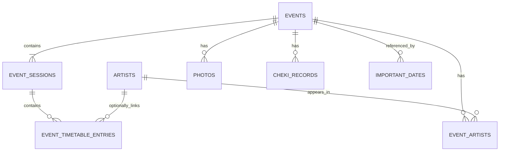

# 活动数据库 v2 设计方案

状态：数据层已在 Migration v18 实现；创建、编辑和详情页已接入多场次与扁平时间表，其余入口待后续提交。
最近更新：2026-08-06。

本文档描述 ota-log 下一代活动数据结构。当前数据库基线是 Migration v18，已实现 schema 的事实来源仍为：

- `src/db/schema.ts`
- `src/db/migrations.ts`
- `src/types/models.ts`
- `src/repositories/`

本文中的 v2 是活动领域版本；对应 SQLite Migration v18。

## 1. 已确认的设计原则

1. **记录优先于现实建模。** Activity 的根本用途是方便用户查看信息和事后回顾，不追求对现实活动组织方式的完整、唯一映射。
2. **继续采用单层活动模型。** Activity 是用户拥有的本地活动记录，不再拆分公开活动事实与用户活动记录。
3. **导入是一次性创建方式。** 从 iEvent、公告或其他来源导入后，活动不持续接收来源更新，也不处理字段覆盖和同步冲突。
4. **所有活动必须有日期。** 每个活动至少包含一个有明确日期的场次，不允许无日期活动或占位场次。
5. **只使用 Activity → Session 两层映射。** 多日、同日多场、多场馆或多舞台都不再增加新的持久化层级。用户可以把两日活动记录为一个 Activity 的两个 Session，也可以分开记录为两个 Activity；两种方式都有效。
6. **场馆保持简单文本。** 不建立全局场馆实体；场次继续保存 `city` 和 `venue`，不引入地址、坐标、别名或场馆合并。
7. **出演关系保持简单。** 只记录活动与艺人的关联和顺序，不区分嘉宾、主持、主办方等角色。
8. **每个活动只保留一个入场支出。** 不建立票种或多笔活动支出模型；手工记录时由用户填写，导入时可以最低可靠入场成本作为可编辑预填值。
9. **时间表保持扁平。** 时间表直接属于具体场次，每条只保存演出内容、时间段和备注，并可选关联本地艺人；不持久化舞台、区域或其他分组层级。
10. **文本是可靠兜底。** 时间表中的演出内容始终保留文本；无法关联本地艺人时不自动创建艺人，也不丢弃文本。
11. **保留现有本地关联。** 照片、拍立得、重要日期和历史 `trip` 兼容数据继续关联活动根记录。

## 2. 本次范围之外

- 持续同步、来源更新、来源删除和重定向。
- canonical activity metadata 与 user activity record 双层模型。
- 字段覆盖、冲突合并和来源历史快照。
- 尚未公布日期的活动。
- 全局场馆库、场馆详情、地图、别名和合并。
- 票种、票面标价、抽选、座位、票号和购票状态。
- 嘉宾、主持、主办方等参与者角色。
- 活动级多笔分类支出；拍立得花费继续由拍立得模型独立计算。
- 持久化父子活动、活动标签和云端账号模型；来源中的父子层级只在导入时投影为用户可编辑的 Activity / Session。
- 舞台、区域、场馆子区等时间表分组模型。
- `trip` 功能复活；历史表和引用仅为兼容保留。

## 3. 核心术语

| 术语 | 含义 |
|---|---|
| 活动（Activity） | 用户拥有的一条本地活动记录。手工创建和导入创建具有相同生命周期。 |
| 场次（Activity Session） | 用户在一个活动下选择的有日期记录单元，可表示一天、昼夜场、某个舞台或其他便于查看与回顾的划分。 |
| 时间表（Activity Timetable） | 某一场次下按顺序排列的扁平条目；每条包含演出内容、时间段和备注，并可选关联本地艺人。 |
| 入场支出（Activity Actual Expense） | 活动级的可编辑入场费用；手工记录通常是用户实际支出，导入可用最低可靠入场成本预填；不包含拍立得、物贩、交通和住宿。 |
| 代表场次（Representative Session） | 列表、首页和倒计时在需要用一个场次代表整个活动时，按统一规则选出的场次。 |

## 4. 总体关系



继续保留 `events` 作为物理根表名称，避免仅为术语统一而重建所有现有外键和 Repository。产品与领域文档统一称其为“活动”。

## 5. 通用约定

- 所有业务主键使用 UUID v4。
- 日期使用 `YYYY-MM-DD`，时间使用 `HH:MM`，时间戳使用 ISO 8601。
- `sort_order` 使用从 0 开始的非负整数，在所属父实体内稳定排序。
- 金额继续使用 `REAL` 以兼容现有数据，并要求非负。
- 每张可编辑主表包含 `created_at`、`updated_at`。
- 图片继续通过 `copyToDocuments()` 保存为永久 URI。
- 活动删除时，沿用现有关联数据的删除或置空规则；本次不扩大删除范围。

## 6. 目标数据结构

### 6.1 `events`

活动根实体。它继续同时保存活动信息和用户记录字段。

| 字段 | 类型 | 约束 | 说明 |
|---|---|---|---|
| `id` | TEXT | PK | 本地 UUID。 |
| `title` | TEXT | NOT NULL | 活动标题。 |
| `event_type` | TEXT | NOT NULL | 继续使用现有活动类型枚举。 |
| `status` | TEXT | NOT NULL | `wishlist`、`planned`、`completed`、`cancelled`。 |
| `review_score` | INTEGER | NULL | 评分，建议限制为 1–5。 |
| `notes` | TEXT | NULL | 用户备注。 |
| `details` | TEXT | NULL | 活动详情。 |
| `url` | TEXT | NULL | 活动相关链接，首期继续只保留一个。 |
| `setlist_text` | TEXT | NULL | 用户记录的 setlist。 |
| `actual_expense` | REAL | NULL | 用户实际支付的入场费用，必须非负。 |
| `trip_id` | TEXT | FK, NULL | 历史兼容引用，不扩展新功能。 |
| `created_at` | TEXT | NOT NULL | 创建时间。 |
| `updated_at` | TEXT | NOT NULL | 更新时间。 |

目标结构不再保留以下根表字段：

- `event_date`、`event_time`：迁入默认场次。
- `city`、`venue`：迁入默认场次。
- `ticket_price`：迁为 `actual_expense`。

约束建议：

```sql
CHECK (review_score IS NULL OR review_score BETWEEN 1 AND 5)
CHECK (actual_expense IS NULL OR actual_expense >= 0)
```

### 6.2 `event_sessions`

表示用户在活动下定义的一个有日期记录单元。单场活动也必须有一个默认场次；该结构有意保持宽松，不要求 Session 与来源网站或现实中的“场次”一一对应。

| 字段 | 类型 | 约束 | 说明 |
|---|---|---|---|
| `id` | TEXT | PK | 本地 UUID。 |
| `event_id` | TEXT | FK, NOT NULL | 所属活动，删除活动时级联删除。 |
| `title` | TEXT | NULL | `DAY 1`、`昼场`、`夜场` 等；默认场次可为空。 |
| `session_date` | TEXT | NOT NULL | 场次当地日期。 |
| `end_date` | TEXT | NULL | 跨午夜时的结束日期；普通场次为空。 |
| `open_time` | TEXT | NULL | 开场或入场时间。 |
| `start_time` | TEXT | NULL | 正式开始时间。 |
| `end_time` | TEXT | NULL | 结束时间。 |
| `city` | TEXT | NULL | 城市文本，保持现有语义。 |
| `venue` | TEXT | NULL | 场馆文本，保持现有语义。 |
| `sort_order` | INTEGER | NOT NULL | 活动内稳定排序。 |
| `created_at` | TEXT | NOT NULL | 创建时间。 |
| `updated_at` | TEXT | NOT NULL | 更新时间。 |

约束和索引：

- `end_date` 为空或不早于 `session_date`。
- `sort_order >= 0`。
- `UNIQUE(event_id, sort_order)`。
- 索引 `(event_id, session_date, start_time, sort_order)`。
- 索引 `(session_date, start_time)`，用于首页、列表、日历和小组件。
- 索引 `(city, session_date)` 与 `(venue, session_date)`，用于筛选和统计。

SQLite 无法在创建活动根记录的同一时刻用普通外键保证“至少一个场次”。该规则由 Repository 事务保证：

- 创建活动时同时创建至少一个场次。
- 编辑活动时禁止删除最后一个场次。
- 保存前验证所有场次都有日期。

场景映射：

| 场景 | 表达方式 |
|---|---|
| 普通单场活动 | 一个无标题默认场次。 |
| 同日昼夜场 | 两个日期相同、标题和时间不同的场次。 |
| 两日活动 | 可记录为一个 Activity 下的 `DAY 1`、`DAY 2`，也可由用户拆成两个 Activity。 |
| 同日多舞台 / 多场馆 | 用户可按便于查看的粒度创建 Session，或只保留一个 Session 并把差异写入时间表文本和备注。 |
| 跨午夜活动 | 一个场次，使用 `session_date`、`end_date` 和结束时间。 |

### 6.3 `event_artists`

继续表示活动与艺人的关联，不引入通用参与者角色。

| 字段 | 类型 | 约束 | 说明 |
|---|---|---|---|
| `event_id` | TEXT | PK, FK | 联合主键之一。 |
| `artist_id` | TEXT | PK, FK | 联合主键之一。 |
| `sort_order` | INTEGER | NOT NULL | 活动内展示顺序。 |

首期只保存活动级出演阵容，不额外建立场次出演关系：

- 活动详情显示活动整体出演者。
- 某位艺人的具体场次和出演时间由时间表条目表达。
- 导入时继续使用现有艺人匹配、未知艺人确认和创建流程。

### 6.4 `event_timetable_entries`

场次时间表中的一条流程。它直接归属 Session，不再经过分组表。

| 字段 | 类型 | 约束 | 说明 |
|---|---|---|---|
| `id` | TEXT | PK | 本地 UUID。 |
| `session_id` | TEXT | FK, NOT NULL | 所属场次，删除场次时级联删除。 |
| `title` | TEXT | NOT NULL | 演出内容文本；无论是否匹配本地艺人都必须保留。 |
| `artist_id` | TEXT | FK, NULL | 可选本地艺人关联；非艺人流程为空。 |
| `start_time` | TEXT | NULL | 开始时间。 |
| `end_time` | TEXT | NULL | 结束时间。 |
| `notes` | TEXT | NULL | 补充说明。 |
| `sort_order` | INTEGER | NOT NULL | 分组内稳定排序。 |
| `created_at` | TEXT | NOT NULL | 创建时间。 |
| `updated_at` | TEXT | NOT NULL | 更新时间。 |

约束和读取规则：

- `UNIQUE(session_id, sort_order)`，且 `sort_order >= 0`。
- 时间允许为空；未知时间的条目仍按 `sort_order` 展示。
- `artist_id` 只提供本地艺人跳转和关联，不替代 `title`；无法匹配时保持为空。
- 时间表条目继承所属场次的日期，不重复保存日期。
- 舞台、区域和特典会等来源信息如有保留价值，写入 `title` 或 `notes`，不新增结构层级。

## 7. 现有关联数据

### 7.1 `photos`

- 继续通过 `event_id` 关联活动。
- 继续保存本地资料图，包括海报、出演阵容图和时间表原图。
- 结构化时间表与时间表图片可以同时存在；图片不参与时间表查询。

### 7.2 `cheki_records`

- 继续通过 `event_id` 关联活动。
- 拍立得单价和总价仍按拍立得 v2 模型计算。
- 活动 `actual_expense` 不包含拍立得花费，统计时可与拍立得花费另行相加。

### 7.3 `important_dates`

- 继续使用 `linked_event_id` 关联活动。
- 活动倒数的目标日期采用代表场次规则，不复制成独立日期事实。

### 7.4 `expenses` 与 `trips`

- `trips` 和通用 `expenses` 作为历史兼容表保留，不扩展新功能。
- 新活动表单只维护 `events.actual_expense`，不再为活动新增多条分类支出。
- Migration 不把历史 `expenses.event_id` 金额自动合并到 `actual_expense`，避免与旧 `ticket_price` 重复计算；迁移前应检查真实存量并保留原数据。

## 8. 查询与产品口径

### 8.1 代表场次

当 UI 只能展示一个日期或场次时：

1. 存在今天或未来场次时，选择最早的今天或未来场次。
2. 所有场次都已结束时，选择最后一个场次。
3. 同日多个场次按 `start_time`、`sort_order` 排序；无开始时间时仅使用 `sort_order`。

首页下一场、活动列表摘要、活动倒数和小组件应共享同一个代表场次选择工具，避免口径漂移。

### 8.2 活动自动完成

- 只有 `status = planned` 的活动参与自动完成。
- 当活动最后一个场次的 `end_date ?? session_date` 早于本地今天时，活动自动改为 `completed`。
- 不因第一个场次结束而提前完成整个多场活动。

### 8.3 日历

- 每个场次独立显示在对应日期。
- 同一活动的场次共享活动标题，并附加非空场次标题。
- 点击任一场次仍进入同一个活动详情页，并定位到对应场次。

### 8.4 活动与场次统计

- “活动数”按 `events.id` 去重，一条多日活动只计一次。
- 年、月归属默认使用活动最早场次日期。
- 艺人出演次数按活动去重，不按时间表条目重复累计。
- 城市和场馆统计按活动与文本值去重；同一活动多个场次在同一场馆只计一次，在不同场馆各计一次。
- 实际支出按活动计一次，并沿用应用当前的统一金额统计口径。

### 8.5 入场支出

- `actual_expense` 是用户最终可编辑的活动级入场费用；手工记录时通常表示用户实际支付金额。
- 导入时直接预填来源中可可靠计算的最低入场成本，不额外弹出价格确认；用户认为不准确时可在表单中修改。
- 不保存多个票种、费用组成或价格来源。
- 不包含拍立得、物贩、交通和住宿。
- UI 文案使用“实际支出”，不使用“票价”。

## 9. 创建与编辑体验

### 9.1 创建活动

- 表单默认创建一个有日期的默认场次。
- 用户可增加同日或不同日期的场次。
- 最后一个场次不可删除。
- 城市和场馆继续使用简单文本输入及历史建议。
- 实际支出只填写一个金额。

### 9.2 编辑活动

- 活动基础信息与场次分区编辑。
- 修改多场活动时明确显示每个场次的日期、时间、城市和场馆。
- 删除场次前提示其时间表也会删除。
- 场次顺序可调整，保存后重写连续 `sort_order`。
- 活动根记录、场次、出演者关联和结构化时间表作为一个聚合在同一 SQLite 事务中保存；任一核心数据写入失败时整体回滚。
- 资料图在核心聚合保存成功后单独更新；图片失败时明确提示活动已保存，避免重试生成重复活动。

### 9.3 时间表

- 在活动详情中按场次显示时间表。
- 支持增加、编辑、删除和排序条目。
- 新建和编辑表单默认只显示「添加时间表」轻量入口，开启后再编辑当前场次的条目。
- 条目支持内容、开始 / 结束时间、备注和可选的活动出演者关联。
- 条目可选关联本地艺人；“开场”“中场休息”等条目无需艺人。

### 9.4 导入

- 导入器生成一条普通本地活动，不建立持续同步关系。
- 单日来源创建一个默认场次；多日或父活动下的多个子活动可以投影为多个场次，但生成的是可编辑草稿，用户仍可自行合并或拆开记录。
- 开场和开演时间分别写入场次字段。
- 来源最低入场成本可可靠计算时直接预填 `actual_expense`，不增加专门提示；用户可在表单中直接修改。
- 来源时间表可解析时写入场次下的扁平条目：演出内容始终保存为文本，时间写入开始 / 结束时间，其他信息写入备注。
- 时间表条目沿用现有艺人匹配与确认流程：不自动创建艺人，只有用户在确认框中选择后才添加；无法关联的内容继续以文本显示。
- 时间表原图仍作为普通活动资料图导入并永久保存。
- 某个子活动详情抓取失败时，保留父页面摘要生成对应场次，继续完成其余导入，并向用户报告部分内容未完整导入。
- 忽略来源的取消状态，不投影为本地活动状态。

## 10. v17 到活动 v2 的已实现迁移

1. Migration v18 创建 `event_sessions` 和直接归属场次的 `event_timetable_entries`；不创建时间表分组表。
2. 为每条旧 `events` 创建一个默认场次：
   - `event_date -> session_date`
   - `event_time -> start_time`
   - `city -> city`
   - `venue -> venue`
3. 为 `event_artists` 增加或通过表重建加入 `sort_order`，旧数据按稳定顺序赋值。
4. 重建 `events`，将旧 `ticket_price` 迁入 `actual_expense`，同时移除根表旧日期、地点和 `ticket_price` 字段。
5. 提供 `event_summaries` 与 `event_first_summaries` 兼容视图；首页、列表和小组件等尚未改版的入口继续读取代表场次投影。
6. Repository 与统计查询切换到场次事实，并新增多场次及结构化时间表 Repository。
7. `photos`、`cheki_records`、`important_dates`、历史 `expenses` 和 `trip_id` 继续引用原 `events.id`，不迁移到第二层记录。
8. 完整备份升级为 v6，保存新活动根表、场次和扁平时间表；恢复旧版备份时自动创建默认场次。

迁移至少覆盖：

- 每条旧活动恰好生成一个默认场次。
- 日期、时间、城市、场馆不丢失。
- `ticket_price` 正确迁为 `actual_expense`。
- 状态、评分、备注、详情、URL 和 setlist 保留。
- 出演者、照片、拍立得、重要日期和历史支出关联不丢失。
- 新装数据库与 v17 升级数据库的最终 schema 一致。
- 外键检查、索引和 CHECK 约束通过。
- 多日、同日多场、跨午夜和多场馆活动的代表场次及统计口径正确。

## 11. 后续实现顺序

数据层已完成 schema、v18 migration、Repository、查询口径、备份 v6 和自动化测试。创建、编辑和详情页已经支持多场次、实际支出与扁平时间表的编辑和展示。后续提交继续完成：

1. 首页、列表、日历、小组件和重要日期直接使用共享的代表场次能力。
2. 导入器支持多场次、开场时间和结构化时间表。
3. 完成 iOS / Android、浅色 / 深色与迁移数据的人工验收后，移除 TypeScript 和 Repository 中仅供旧 UI 使用的兼容字段。
