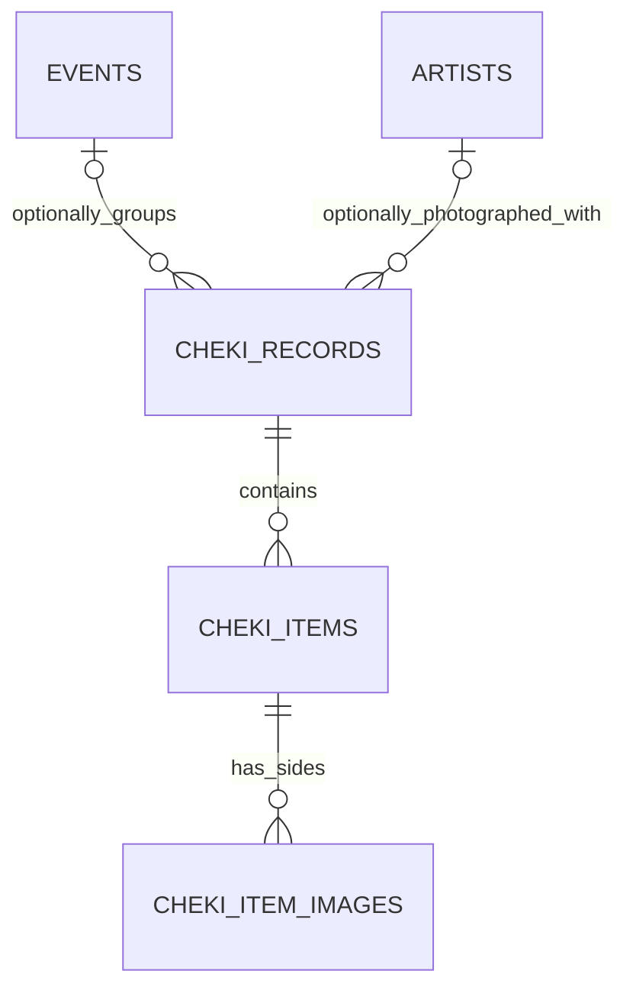

# 拍立得 v2 数据模型

本文档是拍立得 v2 的长期事实源，供开发者和 coding agent 理解领域边界、设计取舍、实现约束与当前进度。具体 SQL、类型签名和页面样式以代码为准；若代码与本文档冲突，应在同一变更中决定修代码还是修文档。

当前状态：

- 数据库 Migration v17 已落地。
- 完整备份格式当前为 v5，已覆盖拍立得 v2 数据与本地媒体。
- Record 新增、详情和编辑流程已接入。
- 电子切册“记录”模式已切换为 Record-first；艺人、相册及其他聚合页面仍在逐步退出兼容投影。
- 活动仍关联现有 `events.id`；活动 v2 属于独立后续工作。

## 1. 核心设计目标

- 用一个统一模型表达有图、无图、图片未补满和多图拍立得记录。
- 让一条记录表达一次拍摄或购买批次，而不是强制一行等于一张图片。
- 分离拍立得总数量、已添加实体单张数和图片文件数，避免统计口径混淆。
- 让同一张实体拍立得的正面和反面保持稳定关联。
- 支持单张价格、单张收藏、单张备注和展示比例，同时保留批次级备注。
- 保留旧数据的数量、金额、艺人、活动、日期、备注、时间戳和图片引用。
- 数据库、Repository、备份、本地媒体与 UI 可以分阶段迁移，但不能产生长期双写或多个事实源。

## 2. 核心术语

| 术语 | 定义 |
|---|---|
| Cheki Record | 一次拍摄或购买批次，是数量、派生总价、艺人、活动、日期和批次备注的聚合根。图片是可选内容。 |
| Cheki Item | Record 中一张可单独识别的实体拍立得，拥有单张整数元单价；图片可以暂时未添加。 |
| Cheki Image | Item 的一个图片面，取值为正面或反面。 |
| Record 数量 | 用户记录的拍立得总数量，是拍立得数量统计的唯一事实。 |
| 已添加单张数 | Record 中至少拥有一张图片的 Item 数量，可以小于 Record 数量。 |
| 图片文件数 | Image 的数量。一个 Item 同时有正反面时贡献两个图片文件。 |
| Item 单价 | 一张实体拍立得的非负整数元价格；输入为空时保存为 0。 |
| Record 总价 | 所有 Item 单价之和的派生值，不单独保存。 |
| Item 展示比例 | 应用于同一 Item 正反面的宽高比，只影响 App 渲染，不修改原图。 |

用户可见文案统一使用“添加图片”“已添加”“已保存”，不使用“归档”描述图片状态或操作。

## 3. 模型关系



```text
Record：数量 5、派生总价 ¥500
├── Item A
│   ├── 正面 Image
│   └── 反面 Image
├── Item B
│   └── 正面 Image
├── Item C：单价 ¥100，尚未添加图片
├── Item D：单价 ¥100，尚未添加图片
└── Item E：单价 ¥100，尚未添加图片
```

三层职责：

- `cheki_records`：批次级关联、数量、日期和备注；总价由 Item 派生。
- `cheki_items`：实体单张、单价、稳定顺序、收藏、展示比例和单张备注。
- `cheki_item_images`：正面或反面的永久本地 URI。

## 4. 关键决策

### 4.1 Record 是聚合根

- 一条 Record 表示一次录入批次，并为数量中的每一张实体拍立得保留一个 Item；Item 可以暂时没有图片。
- 没有图片的记录仍是普通 Record，不再建立“手动记录”这一独立领域类型。
- `quantity >= 1`，且 Item 数必须等于 quantity。
- Item 数可以大于拥有图片的 Item 数，表示仍有拍立得没有添加图片。
- 增加数量时创建无图 Item；减少数量时必须明确移除对应 Item，不能静默丢失单价或单张备注。

### 4.2 艺人、活动与日期属于 Record

- 一条 Record 最多关联一位艺人，当前不支持多艺人。
- 艺人与活动都可为空；删除关联对象时使用 `SET NULL`，不能连带删除 Record。
- UI 中“不关联艺人”是低频操作，新建时必须由用户主动确认。
- 日期属于整条 Record，不属于 Item 或 Image，也不是图片导入时间。
- 当前继续关联 `events.id`，未来活动 v2 落地后再单独迁移。

### 4.3 金额属于 Item，Record 总价派生

- 只保存 Item 单价，不保存 Record 总价。
- 单价使用非负整数，单位直接为元，不使用浮点金额或分为单位的缩放值。
- 用户未填写单价时保存为 `0`；`0` 也是合法的免费价格。
- Record 总价由所有 Item 单价求和得到，统计支出也只汇总 Item 单价。

### 4.4 Item 表示实体单张

- Item 可以暂时没有 Image；图片补录时应绑定到已有 Item，不能重复创建实体单张。
- 收藏、单张备注、展示比例和排序属于 Item。
- 收藏状态属于实体单张，因此正反面共享。
- 正反面共享同一展示比例；默认值为 instax mini 相纸外框比例 `54 / 86`。
- 删除 Item 会同时减少 Record 数量；删除 Image 只移除图片关联并保留 Item，不删除 Documents 中的原图片文件。

### 4.5 Image 表示一面图片

- 每个 Item 最多一张正面和一张反面。
- 正面与反面是两条独立 Image，但不能被 UI 当成两张实体拍立得统计。
- URI 必须由 `copyToDocuments()` 永久化后再保存。
- 替换图片不得使用会先删除旧行的 SQLite `REPLACE` 语义，避免替换过程中短暂失去图片关联。

### 4.6 Record 与 Item 保留两级备注

- Record 备注描述整个批次。
- Item 备注描述某一张实体拍立得。
- Image 不保存独立备注。
- 旧版每张图片的备注迁移到 Item，不能拼接成 Record 备注。

## 5. 权威统计口径

| 指标 | 权威来源 |
|---|---|
| 拍立得总数 | Record 的 `quantity` 之和 |
| 记录数 | Record 行数 |
| 已添加单张数 | 至少拥有一张 Image 的 Item 行数 |
| 正面图片数 | `side = front` 的 Image 行数 |
| 反面图片数 | `side = back` 的 Image 行数 |
| 图片文件数 | Image 行数 |
| 收藏数 | 收藏状态为真的 Item 行数 |
| 总支出 | Item 单价之和 |
| 图片未添加 | 没有任何 Item 拥有 Image 的 Record |
| 图片未补满 | 拥有 Image 的 Item 数小于 quantity 的 Record |
| 图片已补满 | 每个 Item 都至少拥有一张 Image 的 Record |

任何页面、筛选、统计或小组件都不得用 Record 行数、Item 数或 Image 数代替拍立得总数。

## 6. Agent 与实现约束

### 6.1 数据完整性

- Record 与初始 Item/Image 必须在同一事务中创建。
- 编辑 Record 并追加 Item/Image 时必须使用同一事务，任一步失败应整体回滚。
- 创建 Record 时必须按 quantity 同时创建等量 Item；Item 可以暂时没有 Image。
- Repository 负责给调用方返回明确错误；SQLite 约束和 Trigger 负责阻止绕过 Repository 的非法写入。
- 删除 Image 不得连带删除 Item；没有 Image 的 Item 仍代表一张实体拍立得。
- `record_id`、`item_id` 和 Item 跨 Record 移动不能通过普通更新接口修改，若未来需要移动必须设计显式事务。

### 6.2 Repository 与兼容层

- 新业务代码优先使用 `ChekiRecordRepository` 和 Record/Item/Image 聚合类型。
- `ChekiRepository` 与 `ChekiManualEntryRepository` 只承担旧 UI 兼容投影，不应继续增加新的领域能力。
- 兼容投影中的单价直接来自 Item，不得再从 Record 总价反推。
- 多 Item 或图片未补满的 Record 不能伪装成多条可独立编辑总价和数量的旧记录。
- 不要在页面中直接查询三张拍立得表；查询、事务和不变量应收敛在 Repository。

### 6.3 备份、恢复与本地媒体

- 新备份必须同时保存 Record、Item 和 Image，并按父子顺序恢复。
- 旧备份转换必须复用旧数据迁移规则，不能复制第二套分组算法。
- 正反面 URI 都必须进入备份媒体收集、URI rebase、引用计数和未引用媒体扫描。
- 删除数据库记录时不自动删除本地图片；只有显式的“清理未使用图片”功能可以删除未引用文件。
- 不得在旧表与新表之间长期双写。合并后的 Record 无法可靠反向拆回旧有图表和无图表。

### 6.4 UI 约束

- 新增与编辑共用 Record 表单；图片入口在数量之前，用户可以先选图，也可以只填写数量。
- 相册选择器单次最多选择 20 张，可分多次选择，不再用当前 quantity 限制选图数量；图片数超过已填 quantity 时自动提高 quantity。
- 图片可以不添加，也可以少于 quantity；当前新增图片默认作为正面。
- 新建时必须选择艺人，或主动点击“暂不关联艺人”。
- Record 编辑页可以修改批次字段、继续添加图片，并把已有 Item 标记为待移除；新增、移除和 Record 更新在保存时使用同一事务。
- 移除图片不会自动降低 quantity；手动输入的 quantity 不能低于保存后实际保留的 Item 数。
- 选择艺人时从最近一张 Item 带出历史单价（包括合法的 `0`），并默认应用到本次新增的所有 Item；不能覆盖用户本次已经手动编辑的价格。
- 输入完整日期后自动展示同日活动候选，由用户确认关联，不静默选择第一场活动。
- 详情页的图片区域只渲染拥有 Image 的 Item，不把无图 Item 渲染成虚假图片卡；数量摘要仍展示完整 quantity。
- 详情页展示由 Item 单价派生的 Record 总价；Item 查看和编辑页展示、修改单张单价。
- Record 表单不承担背面、收藏、Item 备注和展示比例的完整编辑；新增图片仍默认作为正面，已有 Item 通过独立编辑页维护这些单张属性。
- 不提供独立的 Item 新建页；Item 只能在 Record 新增或编辑流程中创建。`/cheki/items/[id]/edit` 负责正反面增删替换、单张收藏、单张备注和展示比例。
- Record 查看器按正面、背面顺序浏览实际图片；收藏作用于 Item，因此正反面共享收藏状态。查看器提供快捷收藏、编辑和删除整张 Item 的入口。
- 删除 Image 不降低 Record quantity；删除实体 Item 必须同步降低 Record quantity。移除某一面后若另一面仍存在则保留 Item。
- Item 展示比例首轮提供 Mini 竖版、Mini 横版、方形、Wide 横版和自定义宽高比；正反面共享该比例。
- 电子切册“记录”模式不按时间二次分组，每个 Record 独立显示并跳转 Record 详情；相册模式仍以 Item 为浏览单位。
- 旧版“时间”视图偏好必须自动迁移到“记录”，不能让升级用户回退到日期聚合语义。

### 6.5 修改与验证要求

- 修改 schema、Trigger、迁移或 Repository 时必须更新 `src/db/__tests__/` 下的测试。
- 至少覆盖合法边界、超量 Item、数量下调、事务回滚、正反面唯一性、删除生命周期、统计口径与外键 `SET NULL`。
- 修改备份或媒体扫描时必须验证新旧备份恢复和正反面 URI。
- 修改 TypeScript 类型、Repository 或共享表单后至少运行：
  - `rtk npx tsc --noEmit`
  - `rtk npm test -- --runInBand`
- UI 改动同时检查浅色/深色、iOS/Android、键盘遮挡、返回未保存确认、图片未添加和图片未补满状态。

## 7. v16 到 v17 的迁移原则

旧版 `cheki` 和 `cheki_manual_entries` 已通过确定性迁移统一为 Record：

- 有活动时按“活动 + 艺人 + 有效日期”分组。
- 无活动时按“有效日期 + 艺人”分组。
- 艺人为空时无法证明属于同一批次，每条旧来源独立迁移。
- 有效日期依次取记录日期、活动日期、创建日期。
- 每个分组的 quantity 为旧有图行数与旧无图数量之和。
- 每条旧有图记录的 `price` 作为该 Item 的来源单价独立四舍五入；空值保存为 `0`。
- 旧无图记录的 `total_price` 先整体四舍五入，再按 count 确定性分配到对应 Item，余数从前往后每张加 `1`。
- 每条旧有图记录生成一个 Item 和一张正面 Image；旧无图数量中的每一张也生成无图 Item。
- 旧图片备注进入 Item；旧 Item 默认不收藏并使用 `54 / 86` 展示比例。
- 分组与 Item 顺序必须稳定，不能依赖数据库扫描或容器遍历的偶然顺序。

迁移及旧备份恢复必须保证数量守恒、金额规则一致、图片引用唯一、外键有效，并且不删除本地图片。

## 8. TODO

### 已完成

- [x] Migration v17 三表 schema、索引、约束与 Trigger。
- [x] v16 旧数据确定性迁移与迁移测试。
- [x] Record/Item/Image Repository、聚合事务与权威统计。
- [x] 旧 UI 兼容投影。
- [x] 完整备份 v5、旧备份恢复、本地媒体扫描与 URI 处理。
- [x] Record 新增、详情和编辑页面。
- [x] 图片优先、图片可选、单次选图 20 张、选图自动提高数量、主动确认不关联艺人的新增流程。
- [x] Record 创建，以及编辑时新增和移除图片的聚合事务测试。
- [x] 电子切册“时间”模式重构为“记录”模式，每个 Record 独立展示并进入详情。
- [x] “记录”模式接入 Record 级搜索、筛选、排序及旧视图偏好迁移。
- [x] 明确 Item 不设独立新增页，已有 Item 使用独立编辑页；查看器提供单张编辑和删除快捷入口。
- [x] Record 详情与 Item 编辑支持正反面查看、添加、替换和移除。
- [x] Item 编辑与查看器支持单张收藏，并在文案上与收藏艺人区分。
- [x] Item 编辑支持比例预置和自定义宽高比，Record 缩略图按保存比例展示。

### 下一步

- [ ] 将 Item 收藏、正反面和展示比例接入电子切册相册模式及后续聚合页面，移除兼容投影造成的单面和固定比例限制。
- [ ] 将艺人、相册及其他入口的搜索筛选从兼容投影完全迁移到 Record/Item。
- [ ] 更新统计页，明确总数量、记录数、已添加单张数、收藏数和总支出。
- [ ] 更新活动详情、艺人详情、日历、首页和小组件的 Record 聚合展示与跳转。
- [ ] UI 全面切换后移除旧路由、旧类型和兼容 Repository。

## 9. 已确认与非目标

已确认：

- Item 不提供独立新增页；已有 Item 使用独立编辑页，查看器提供收藏、编辑和删除快捷操作。
- 展示比例提供迷你竖版、迷你横版、方形、宽幅横版及自定义宽高比。

当前非目标：

- 活动 v2 或 `events` 表重构。
- 一条 Record 关联多个艺人。
- Record 级源总价；Record 总价由 Item 单价派生。
- 云同步、账号系统和多设备冲突处理。
- 删除 Record、Item 或 Image 时自动删除本地图片文件。
